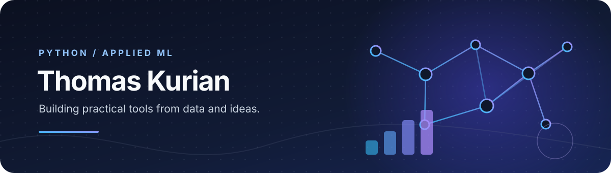
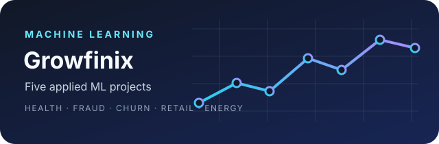
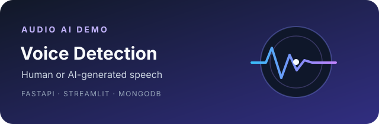

  

  <a href="https://github.com/leojoeltk?tab=repositories">Explore my repositories</a>

---

## Selected work

<table>
  <tr>
    <td width="50%" valign="top">
      
      
<a href="https://github.com/leojoeltk/Growfinix"><strong>Growfinix</strong></a> A portfolio of five projects covering health prediction, fraud detection, customer churn, retail analytics, and energy forecasting.

      
Python · scikit-learn · Pandas

    </td>
    <td width="50%" valign="top">
      
      
<a href="https://github.com/leojoeltk/Hackathon_GUVI"><strong>AI-Generated Voice Detection</strong></a> A full-stack audio-classification demo with an API, web interface, and detection history.

      
FastAPI · Streamlit · MongoDB

    </td>
  </tr>
</table>

## Toolkit

  
  
  
  
  

Pandas · NumPy
